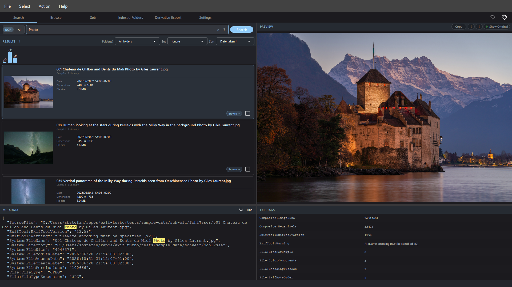

# exif-turbo

Find photos by their metadata or by describing what they show. exif-turbo is a
local-first desktop app for searching and browsing large photo and video
collections on Windows, macOS, and Linux.

[Download the latest release](https://github.com/baddonkey/exif-turbo/releases) ·
[Read the User Manual](docs/user-manual.md)

[](docs/screenshots/exif-turbo-demo.mp4)

*The demo and poster include photographs by © Giles Laurent, licensed CC BY-SA 4.0; see [screenshot attribution](docs/screenshots/README.md).*

## What it does

- **Search metadata:** Find images and videos by EXIF, IPTC, XMP, and other embedded metadata, with text, date, and folder filters.
- **Search by image meaning:** Use natural-language AI search to find photos by their visual content, not just their filenames or tags. AI search runs locally after its model is available.
- **Browse and inspect:** Browse indexed folders, preview media, and inspect metadata and EXIF tags.
- **Organize without changing originals:** Add custom tags, search them, and export tagged copies while leaving source files untouched.
- **Keep the index local:** Password-protected databases encrypt the index and supported thumbnail, preview, and AI caches at rest.
- **Handle varied libraries:** Index common photo, RAW, and video formats; the interface is available in five languages.

## Install

Download the installer for your platform from [GitHub Releases](https://github.com/baddonkey/exif-turbo/releases):

- **Windows:** MSI installer; ExifTool is included.
- **macOS:** Apple silicon DMG; install ExifTool separately.
- **Linux:** Debian/Ubuntu DEB or Fedora/openSUSE RPM; install ExifTool separately.

See the [User Manual](docs/user-manual.md#2-installation) for setup and first-run instructions.

## MCP batch selection

The running desktop app's MCP interface lets an assistant choose an image set
before applying custom tags to a batch:

```python
list_image_sets()
get_image_set_images(set_id=1, include_previews=True)
```

The first call lists sets with their IDs, names, and member counts. The second
returns a page of images with existing custom tags, metadata, and available JPEG
previews. With previews enabled, the default and maximum page size is 5 images;
without previews, the default is 25 and the maximum is 50. Pass the returned
`next_offset` as `offset` to fetch another page until `next_offset` is `null`.
Use the chosen image IDs and paths with `set_custom_tags_batch` to append or
replace custom tags.

The single-image tools `get_selected_image` and `add_custom_tags` follow the
tagging drawer's selection. In Sets, select a member first; they never fall back
to an unrelated Search selection while a set is active. `add_custom_tags` updates
only that selected image, not the entire set. Check the path returned by
`get_selected_image` before tagging, and use `set_custom_tags_batch` with explicit
image IDs and paths for batch updates.

Successful MCP tag updates write an INFO log entry per image with the tool name,
image ID, target path, append/replace mode, requested tags, and resulting custom
tags. Failed updates are not logged as successes.

## Privacy

Indexing and search run locally. Password protection covers the database and
supported caches, not original media, exports, tagging sidecars, settings,
diagnostic output, or data in application memory. See [What the password
protects](docs/user-manual.md#what-the-password-protects) for the full scope.

## More information

- [User Manual](docs/user-manual.md)
- [AI performance measurements](docs/ai-performance.md)
- [CI quality checks](docs/continuous-integration.md)
- [License](LICENSE) and [third-party software notices](THIRD-PARTY-LICENSES.md)

Sample-photo sources and licenses are listed in the [attribution manifest](tests/sample-data/ATTRIBUTION.md).